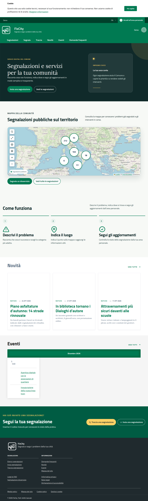

> Screenshot reale del front office FixCity, verificato il 23 novembre 2026. Per questo modulo è una superficie condivisa: il manuale non attribuisce al modulo una UI propria se non documentata dalle fonti.

# Manuale d'uso per attori — Tenant

## Scopo e perimetro

Tenant è il modulo infrastrutturale che rappresenta il contesto tenant:
identità del tenant, dominio, slug, database, impostazioni, stato attivo e
associazioni agli utenti. Non è un ruolo e non sostituisce l'autorizzazione
delle risorse applicative.

## Attori e capacità effettive

| Attore | Capacità nel modulo Tenant |
|---|---|
| Ospite | N/A: non amministra tenant. Può vedere un'esperienza pubblica solo se l'applicazione risolve un tenant attivo per quella richiesta. |
| Utente autenticato | N/A come capacità diretta; può lavorare nel contesto del tenant selezionato quando il pannello lo configura e la sua applicazione lo ammette. |
| Utente in gruppo/ruolo | N/A come grant automatico: membership, ruolo applicativo e tenant corrente sono concetti distinti. |
| Admin | N/A salvo il ruolo esplicito `tenant::admin`, che il `TenantBasePolicy` tratta come amministratore del modulo Tenant. |
| Super-admin | Il `TenantBasePolicy` concede il bypass delle abilità del modulo. Le impostazioni della pagina Tenant risultano comunque esposte esplicitamente al super-admin. |
| Operatore/moderatore | N/A nel modulo Tenant: non è definita una capacità uniforme per questi nomi di ruolo. |

## Flussi operativi

### Selezione del contesto

Un pannello che abilita la tenancy usa il modello tenant configurato da Xot,
con `slug` come identificatore e con registrazione/profilo tenant predisposti.
L'utente opera quindi nel tenant corrente solo in quei pannelli. La tenancy non
è attiva automaticamente in ogni pannello: il provider base la disattiva di
default e il pannello deve abilitarla.

### Amministrazione tenant

Il ruolo `tenant::admin` può superare le policy del modulo Tenant; il
super-admin ha lo stesso bypass in forma globale. La pagina di impostazione
Tenant è riservata al super-admin e consente le impostazioni esposte dalla
pagina, come titolo e altezza del logo. Non si deducono da questo manuale
permessi di gestione delle risorse degli altri moduli.

## Prerequisiti

- un tenant esistente e attivo, con slug/configurazione coerenti;
- un pannello che abbia abilitato esplicitamente la tenancy;
- autenticazione e ruolo ammesso dalla policy per le operazioni amministrative;
- configurazione del modello tenant e delle connessioni prevista
  dall'installazione.

## Limiti e casi N/A

- Tenant non attribuisce da solo ruoli, permessi o accesso ai pannelli.
- Non ogni pannello è tenant-aware; non va promesso isolamento per le pagine che
  non applicano la tenancy.
- Il ruolo generico `admin`, `moderator` o `operator` non è sufficiente secondo
  la policy Tenant, se non esiste anche una regola applicabile.
- Dominio, database e impostazioni sono dati del contesto tenant: le capacità
  operative sulle risorse restano responsabilità del modulo che le possiede.

## Fonti verificabili

- `app/Models/Tenant.php` — attributi, stato attivo, URL e associazioni.
- `app/Models/Policies/TenantBasePolicy.php` — bypass `super-admin` e
  `tenant::admin`.
- `app/Filament/Pages/SettingPage.php` — impostazioni riservate al
  super-admin.
- `Modules/Xot/app/Actions/Panel/ApplyTenancyToPanelAction.php` — modello,
  slug e pagine di registrazione/profilo tenant.
- `Modules/Xot/app/Providers/Filament/XotBasePanelProvider.php` — tenancy
  opzionale nei pannelli.

